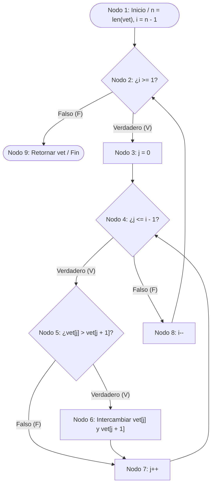

# Laboratorio 04: Pruebas Unitarias (xUnit) y Cobertura de Código

- **Curso:** Ingeniería de Software II
- **Docente:** DSc. Edgar Sarmiento Calisaya
- **Lenguaje de programación:** Python 3
- **Framework xUnit:** `unittest` (PyUnit)
- **Herramienta de Cobertura:** `coverage.py`
- **Algoritmo bajo prueba:** Ordenamiento Burbuja (*BubbleSort*) bajo el paradigma Orientado a Objetos.

---

## 1. Grafo de Flujo de Control y Complejidad Ciclomática

### Algoritmo de Referencia
```python
class Ordenador:
    def bubble_sort(self, vet: list) -> list:
        n = len(vet)                        # Nodo 1
        for i in range(n - 1, 0, -1):       # Nodo 2 (Condición: i >= 1) / Nodo 8 (i--)
            for j in range(0, i):           # Nodo 3 (j = 0) / Nodo 4 (Condición: j <= i - 1) / Nodo 7 (j++)
                if vet[j] > vet[j + 1]:     # Nodo 5 (Condición: vet[j] > vet[j + 1])
                    aux = vet[j]            # Nodo 6 (Swap)
                    vet[j] = vet[j + 1]
                    vet[j + 1] = aux
        return vet                          # Nodo 9
```

### Diagrama de Flujo de Control (GFC)



### Cálculo de la Complejidad Ciclomática $V(G)$
* **Nodos de decisión (predicados $P$):** 3 (`Nodo 2`, `Nodo 4`, `Nodo 5`)
* **Fórmula por nodos predicados:**
  $$V(G) = P + 1 = 3 + 1 = 4$$
* **Fórmula por aristas y nodos ($E - N + 2$):**
  $$V(G) = 11 - 9 + 2 = 4$$

---

## 2. Especificación de Casos de Prueba (Formato Tabular)

| ID CP | Camino en el Grafo | Valores de Prueba (`vet`) | Resultado Esperado | Justificación de Cobertura |
| :--- | :--- | :--- | :--- | :--- |
| **CP1** | $1 \to 2(F) \to 9$ | `[5]` | `[5]` | Lista con longitud $< 2$; no ingresa al bucle exterior ni al interior. |
| **CP2** | $1 \to 2(V) \to 3 \to 4(V) \to 5(F) \to 7 \to 4(F) \to 8 \to 2(F) \to 9$ | `[1, 2]` | `[1, 2]` | Lista ya ordenada; ejercita la rama falsa de la condición de intercambio (`Nodo 5`). |
| **CP3** | $1 \to 2(V) \to 3 \to 4(V) \to 5(V) \to 6 \to 7 \to 4(F) \to 8 \to 2(F) \to 9$ | `[2, 1]` | `[1, 2]` | Lista desordenada; ejercita la rama verdadera de intercambio (`Nodo 6`). |
| **CP4** | Iteraciones múltiples sobre $1 \to 2 \to 3 \to 4 \to 5 \to 6 \to 7 \to 8 \to 9$ | `[4, 3, 2, 1]` | `[1, 2, 3, 4]` | Lista completamente invertida; valida múltiples ciclos anidados e intercambios sucesivos. |

---

## 3. Estructura del Proyecto

```text
LAB04/
├── src/
│   ├── __init__.py
│   └── bubble_sort.py          # Clase Ordenador con el método bubble_sort
├── tests/
│   ├── __init__.py
│   └── test_bubble_sort.py     # Suite de pruebas unitarias con unittest (Arrange-Act-Assert)
├── htmlcov/                    # Reporte visual HTML generado por coverage.py
├── .coveragerc                 # Configuración de cobertura de código y ramas
├── requirements.txt            # Dependencias del proyecto (coverage==7.6.4)
└── README.md                   # Documentación y entregables del laboratorio
```

---

## 4. Ejecución de Pruebas y Cobertura

### 1. Crear entorno virtual e instalar dependencias
```bash
python3 -m venv venv
source venv/bin/activate
pip install -r requirements.txt
```

### 2. Ejecutar casos de prueba (`unittest`) con `coverage.py`
```bash
coverage run -m unittest discover -s tests -v
```

### 3. Generar reporte de cobertura en consola y HTML
```bash
coverage report -m
coverage html
```

---

## 5. Resultados Obtenidos

### Reporte de Ejecución de Casos de Prueba (`unittest`)
```text
test_cp1_un_solo_elemento (test_bubble_sort.TestBubbleSort.test_cp1_un_solo_elemento) ... ok
test_cp2_lista_ya_ordenada (test_bubble_sort.TestBubbleSort.test_cp2_lista_ya_ordenada) ... ok
test_cp3_lista_desordenada_con_swap (test_bubble_sort.TestBubbleSort.test_cp3_lista_desordenada_con_swap) ... ok
test_cp4_lista_completamente_invertida (test_bubble_sort.TestBubbleSort.test_cp4_lista_completamente_invertida) ... ok

----------------------------------------------------------------------
Ran 4 tests in 0.001s

OK
```

### Reporte de Cobertura de Código (`coverage.py`)
```text
Name                 Stmts   Miss Branch BrPart  Cover   Missing
----------------------------------------------------------------
src/__init__.py          0      0      0      0   100%
src/bubble_sort.py      10      0      6      0   100%
----------------------------------------------------------------
TOTAL                   10      0      6      0   100%
```

El reporte interactivo HTML se encuentra generado en [`htmlcov/index.html`](htmlcov/index.html).

